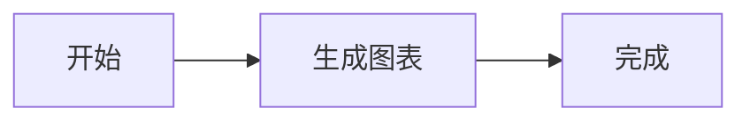

<p align="center">
  
</p>

<h1 align="center">Godot DocRender</h1>

<p align="center">
  <b>Markdown, LaTeX, and Mermaid rendering for Godot 4.</b>
</p>

<p align="center">
  <a href="LICENSE.txt">
    
  </a>
  <a href="https://godotengine.org">
    
  </a>
  <a href="#platform-support">
    
  </a>
  <a href="https://github.com/godothub/godot-gif">
    
  </a>
</p>

<p align="center">
  Render interactive documents with MarkdownLabel, standalone formulas with LatexLabel and LatexLabel3D, and diagrams with MermaidLabel.<br>
  Use TeXRender and MermaidRender from scripts, or preview Markdown as you edit it in the Godot Script Editor.
</p>

---

## What You Can Build

- Game UI, documentation panels, and chat windows with searchable and selectable Markdown.
- Incremental output with `MarkdownLabel.append_text()` and `finish_stream()`.
- In-game formulas and diagrams styled through Godot themes.

## Highlights

### Markdown Rendering

- ATX headings (`#` to `######`)
- Paragraphs and thematic breaks
- Fenced code blocks
- Ordered, unordered, nested, and task lists
- Nested blockquotes
- Tables
- Footnotes
- Inline bold, italic, bold-italic, code, strikethrough, and highlight
- Links, images, and linked images

### LaTeX Formulas

Enable `parse_latex` on a `MarkdownLabel` to render inline formulas with `$...$` and display formulas with `$$...$$`. Use `LatexLabel` for standalone formulas in UI, `LatexLabel3D` for formulas in 3D scenes, and `TeXRender` for rendering from scripts. [TeXRender class reference](doc_classes/TeXRender.xml)

### Mermaid Diagrams

Enable `parse_mermaid` on a `MarkdownLabel` to render fenced `mermaid` blocks. The editor's Markdown preview enables it automatically. The diagram palette follows the theme's text color. Blocks show their source while rendering or when the backend cannot render them.



Use a `MermaidLabel` node to display a standalone diagram. Enter raw Mermaid source in its `text` property and choose Auto, Light, or Dark in `theme_mode`. The node renders in the background and reports the result through `render_finished`, `get_texture()`, and `get_render_error()`.

Use `MermaidRender` from scripts to export diagrams or inspect their semantic and layout data. Pass Merman options as a dictionary and use `MermaidRender.get_runtime_catalog()` to discover available operations. [Godot class reference](doc_classes/MermaidRender.xml) · [Merman options](https://github.com/Latias94/merman/blob/v0.9.3/docs/bindings/OPTIONS_JSON.md)

```gdscript
extends TextureRect


func _ready() -> void:
	var renderer: MermaidRender = MermaidRender.new()
	var options: Dictionary = {
		"site_config": {
			"theme": "dark",
			"themeVariables": {
				"lineColor": "#70b9ff",
			},
		},
		"raster": {
			"scale": 2.0,
		},
	}
	var status: Error = renderer.render("flowchart LR\nA[Start] --> B[Done]", &"png", options)
	if status == OK:
		texture = renderer.get_texture()
	else:
		push_error(renderer.get_render_error())
```

The Merman backend is available on Windows x64 MSVC builds. Install the pinned SDK before running SCons. [Merman](https://github.com/Latias94/merman)

```powershell
python scripts/fetch_merman_sdk.py
```

### Images

- Loads images from `res://`, `user://`, `uid://`, `http://`, and `https://`.
- Local and remote images are loaded asynchronously.
- Failed images show a themeable `file_broken` icon.
- Failed images display alt text next to the broken icon when alt text exists.
- Empty alt text stays empty; no fallback file name is shown.
- Network PNG/JPG/WebP images are decoded at runtime.

### Streaming And Long Text

- `streaming_enabled` enables incremental tail reparsing for append-heavy workflows.
- `finish_stream()` performs final full parsing for document-level state such as footnotes and anchors.
- Stable layout prefix reuse reduces repeated work during streaming.
- Visible range drawing skips off-screen content to improve long document scrolling.

### Interaction

- Scrollable document view.
- Text selection, copy, select-all, and drag selected text.
- Search and scroll to search result.
- Link activation and optional external link opening.
- Heading anchors and scroll-to-anchor helpers.

### Theme Integration

All visual styling is read from the Godot theme system under the type name `MarkdownLabel`, including fonts, font sizes, colors, constants, styleboxes, and icons.

See the full theme reference:

```text
addons/docrender/docs/markdown_label_theme_reference.md
```

Apply the example theme to a `LatexLabel` node to style standalone formulas. [LatexLabel example theme](addons/docrender/example/latex_label_theme.tres) · [LatexLabel theme reference](addons/docrender/docs/latex_label_theme_reference.md)

Use the example `MermaidLabel` theme to edit diagram node fills, borders, text, and connections. [MermaidLabel example theme](addons/docrender/example/mermaid_label_theme.tres) · [MermaidLabel theme reference](addons/docrender/docs/mermaid_label_theme_reference.md)

## Quick Start

### 1. Install The Addon

Copy the bundled addon folder into your Godot project. If you use the `godot-docrender` CI artifact, extract its contents into this folder.

```text
addons/docrender
```

Then make sure the GDExtension file is present:

```text
addons/docrender/docrender.gdextension
```

### 2. Add A MarkdownLabel Node

Add a `MarkdownLabel` node to your scene and set its `text` property, or set Markdown from code:

```gdscript
@onready var markdown_label: MarkdownLabel = %MarkdownLabel

func _ready() -> void:
    markdown_label.set_markdown_text("# Hello\n\nThis is **Markdown**.")
```

### 3. Stream Text

For AI chat, console output, or other incremental text:

```gdscript
markdown_label.streaming_enabled = true
markdown_label.clear()

markdown_label.append_text("# Answer\n\n")
markdown_label.append_text("This paragraph is being streamed")
markdown_label.append_text(" in multiple chunks.")

markdown_label.finish_stream()
```

Call `finish_stream()` after the final chunk. It forces a final full parse so document-level features such as footnotes, anchors, and lists settle into their final state.

## Import LaTeX and Mermaid Files

Place a UTF-8 `.tex` or `.mmd` file in your Godot project.

The LaTeX Document importer imports `.tex` files as `LatexDocument`. The Mermaid Document importer imports `.mmd` files as `MermaidDocument`. Use `get_text()` on either resource to read the original source and assign it to a node's `text` property.

Both document types inherit `Resource` directly. The editor reimports files from the former DocRender Source importer on project load and keeps their existing resource UIDs. If you used the removed `DocRenderSource` type in scripts or saved standalone resources with it, update them to the appropriate document type. Use the resource class to distinguish the formats.

In Godot 4.7.2, double-click an imported `.tex` or `.mmd` file in the FileSystem tree or file list to edit its source in the built-in ScriptEditor. Use the ScriptEditor File menu to save the source or save it to a new path.

```gdscript
@export var diagram_source: MermaidDocument
@onready var diagram: MermaidLabel = %MermaidLabel


func _ready() -> void:
	if diagram_source != null:
		diagram.text = diagram_source.get_text()
```

Godot 4.7.2 also recognizes `.tex` as an `ImageTexture` extension, so its binary loader can log `Unrecognized binary resource file` when it scans a LaTeX file for dependencies. DocRender's import still produces a `LatexDocument`.

## Import a PDF Page as a Texture

On Windows x64, add a `.pdf` to the project and select it in the FileSystem dock. In the Import dock, choose **PDF Texture**, set the page number (starting at 1) and DPI, and click **Reimport**. The default is page 1 at 144 DPI with a white background. Assign the resulting [PDFTexture](doc_classes/PDFTexture.xml) to any `Texture2D` property. Exported games load the imported pixels directly.

For a source build, run `python scripts/fetch_pdfium_sdk.py` before SCons. For offline setup, pass `--archive <path-to-pdfium-win-x64.tgz>` with the [pinned release archive](https://github.com/bblanchon/pdfium-binaries/releases/tag/chromium/8152). The Windows x64 build copies `pdfium.dll` to the addon's `bin` directory for the editor.

## Images And GIFs

MarkdownLabel supports standard Markdown image syntax:

```markdown


[](https://example.com)
```

Image behavior:

- Images load asynchronously.
- Loading images reserve inline space but do not show the broken icon yet.
- Broken image placeholders appear only after loading fails.
- `file_broken` is themeable.
- The default broken icon is `uid://cn51pvobw1gxd`, from `addons/docrender/icons/file_broken.svg`.

GIF support is optional:

- GIF playback depends on [godothub/godot-gif](https://github.com/godothub/godot-gif).
- If Godot-GIF is not installed and its runtime classes are unavailable, GIF images show the broken image placeholder.
- If Godot-GIF is installed, MarkdownLabel attempts to load local and remote GIFs as `GIFTexture` and advance frames inline.

## Platform Support

| Platform | Status | Notes |
|----------|--------|-------|
| Windows x86_64 | Supported | Main development and test target |
| Linux | Build required | Add the compiled library path to `docrender.gdextension` |
| macOS | Build required | Not shipped in this repository by default |
| Android | Build required | Network image behavior depends on export/network permissions |
| Web | Experimental | Remote image requests may be limited by browser/CORS/runtime constraints |

The repository currently ships/configures Windows x86_64 library entries:

```ini
windows.debug.x86_64 = "bin/docrender.windows.template_debug.x86_64.dll"
windows.release.x86_64 = "bin/docrender.windows.template_release.x86_64.dll"
```

Other platforms require building the GDExtension yourself.

## Editor Localization

Godot DocRender follows the Godot editor language. Select Simplified Chinese and restart the editor to see the translated Markdown preview menu and built-in class reference. Set the Inspector property name style to Localized to see translated property names. English is the source language for untranslated entries.

See [Localization tools](tools/README.md) to update or validate the translation catalogs.

## Requirements

- **Godot:** 4.5 or later in the extension configuration; development has primarily been tested with Godot 4.7.
- **Language:** C++17 or newer.
- **Build system:** SCons.

Source builds use the required submodules and any SDKs installed for optional features. [Third-party Libraries](#third-party-libraries)

Initialize submodules before building:

```powershell
git submodule update --init --recursive
```

Open `Godot-DocRender.sln` to browse the C++ project in Visual Studio. SCons builds the GDExtension.

Build Windows debug:

```powershell
scons godot-docrender platform=windows target=template_debug arch=x86_64
```

Build Windows release:

```powershell
scons godot-docrender platform=windows target=template_release arch=x86_64
```

## Current Limitations

- Full HTML rendering is not supported.
- Markdown compatibility is practical but not fully CommonMark/GitHub Markdown compliant.
- Network image cache is process-local only; there is no disk cache.
- GIF animation requires Godot-GIF and may depend on that plugin's runtime behavior.
- Very large remote images can increase memory and VRAM usage.
- Remote images may fail in restricted network environments or exported platforms without the required permissions.

## License

Godot DocRender's own code is licensed under the MIT License. [LICENSE.txt](LICENSE.txt)

## Third-party Libraries

| Library | Used for | How it is included | License |
| --- | --- | --- | --- |
| [godot-cpp](https://github.com/godotengine/godot-cpp/tree/4.5) | C++ bindings for the Godot GDExtension API | Required Git submodule | MIT |
| [MicroTeX](https://github.com/NanoMichael/MicroTeX) | LaTeX formula layout for `TeXRender`, the LaTeX nodes, and Markdown math | Required Git submodule, built into the extension with its math fonts | MIT for the library. Fonts have separate licenses. |
| [TinyXML-2](https://github.com/leethomason/tinyxml2) | XML resource parsing for MicroTeX | Required Git submodule, built into the extension | zlib |
| [Merman 0.9.3](https://github.com/Latias94/merman/releases/tag/v0.9.3) | Mermaid layout and rendering for `MermaidRender`, `MermaidLabel`, and Markdown Mermaid blocks | Optional SDK statically linked in Windows x64 MSVC builds. [SDK installer](scripts/fetch_merman_sdk.py) | MIT or Apache-2.0 for Merman's code. Bundled components have separate notices. |
| [PDFium](https://pdfium.googlesource.com/pdfium/) | Rasterizes a PDF page during `PDFTexture` import | Optional Windows x64 editor DLL from [pdfium-binaries](https://github.com/bblanchon/pdfium-binaries/releases/tag/chromium/8152). [SDK installer](scripts/fetch_pdfium_sdk.py) | BSD-3-Clause for PDFium. The binary package includes its own MIT license and component notices. |
| [Godot-GIF](https://github.com/godothub/godot-gif) | GIF decoding and playback in `MarkdownLabel` through `GIFTexture` | Optional Godot addon installed separately | MIT |
| [Babel](https://babel.pocoo.org/) | Updating and validating editor translation catalogs | Python dependency for [localization tools](tools/README.md) | BSD-3-Clause |

The addon includes notices for MicroTeX, TinyXML-2, and the embedded math fonts. [MicroTeX-LICENSES.txt](addons/docrender/MicroTeX-LICENSES.txt)

The Windows x64 CI artifacts include SDK notices in `Merman-LICENSES/` and `PDFium-LICENSES/`. Exported games load the baked PDF textures directly.
