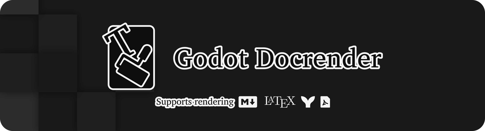

Render Markdown, LaTeX formulas, Mermaid diagrams, and PDF pages in Godot 4.5+.

## Features

###  Interactive Markdown

Add a `MarkdownLabel` to a scene and set its `text` property. It supports selection, search, links, and streaming text. [MarkdownLabel](doc_classes/MarkdownLabel.xml)

###    LaTeX formulas and Mermaid diagrams

Display them in Markdown or in standalone nodes. Use `LatexLabel` in UI, `LatexLabel3D` in 3D scenes, and `MermaidLabel` for diagrams on Windows x64 with the Merman backend. [LatexLabel](doc_classes/LatexLabel.xml) · [MermaidLabel](doc_classes/MermaidLabel.xml)

###  PDF textures and scripting

On Windows x64, import a PDF page as a `PDFTexture` or read and edit PDFs from GDScript. Add `docrender_pdf_reader` to a Windows x64 export preset to include PDFium for runtime reading and writing. [PDFTexture](doc_classes/PDFTexture.xml) · [PDFReader](doc_classes/PDFReader.xml) · [PDFWriter](doc_classes/PDFWriter.xml)

## Install

Copy the bundled `addons/docrender` folder into your Godot project. If you use the merged `godot-docrender` CI artifact, extract its contents into your project's `addons/docrender` folder. Choose a package that includes the GDExtension binary for your platform. [Build from source](CONTRIBUTING.md)

## License

Godot DocRender is licensed under MIT. [License](LICENSE.txt) · [Third-party notices](addons/docrender/THIRD-PARTY-NOTICES.md)
